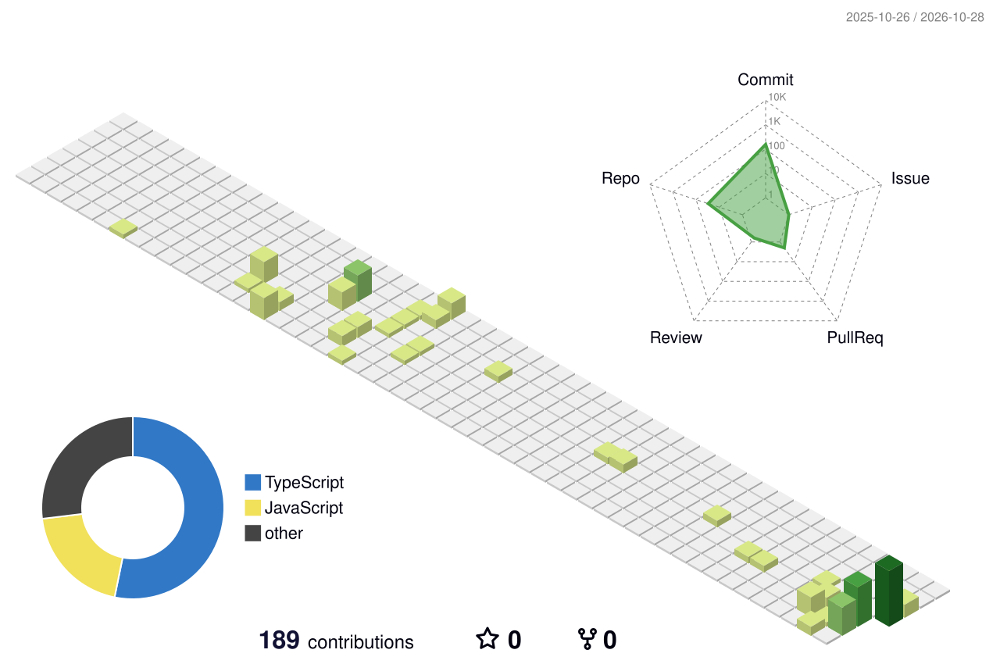

 

## 👋 About

I build and deploy full-stack apps with **React, Node.js, ASP.NET Core and Python**, and add practical AI features to real products.

- 🏢 Now at **Mintergraph** (Jaipur), building an HR Quarterly Review & Appraisal System on the MERN stack
- 🎓 MCA (2026) · BCA (2024), Sri Balaji College of Engineering and Technology
- 📍 Rajasthan, India · Open to remote work and relocation

**⚡ ~30%** faster SQL queries &nbsp;·&nbsp; **🤖 60–80%** fewer redundant Gemini calls &nbsp;·&nbsp; **👥 3-role** HR platform

## 🧊 Activity

## 🚀 Projects

<table>
<tr>
<td width="50%" valign="top">

**📞 [TaskFlow](https://github.com/Chirag-Tank1971/TaskFlow)** 
AI lead & call management with Gemini categorization, a RAG knowledge base and role-based access. 
React · Node.js · MongoDB · Gemini · Chroma 
[Live demo](https://task-flow-five-snowy.vercel.app) · [Source](https://github.com/Chirag-Tank1971/TaskFlow)

</td>
<td width="50%" valign="top">

**🏢 HR Review & Appraisal System** 
Multi-role platform with admin, manager and employee workflows and automated KRA scoring. 
MongoDB · Express · React · Node.js

</td>
</tr>
<tr>
<td valign="top">

**📈 Binance Futures Trading Bot** 
FastAPI bot on the Futures Testnet with MARKET/LIMIT orders, logging and error handling. 
Python · FastAPI · python-binance

</td>
<td valign="top">

**🗂️ Earlier work** 
SwiftMart · Personalized News Digest · Task Management System · YapShare

</td>
</tr>
</table>

## 💼 Experience

- **Full Stack Developer, Mintergraph** · Sept 2026 – Present
- **Associate Full Stack Developer (Contract), Myna Solutions** · Oct 2025 – Jan 2026
- **.NET Full Stack Developer Intern, Pratham Software** · May – Aug 2025
- **Full-Stack Web Developer Intern, The Good Custom** · 3 months

## 🛠️ Stack

 

