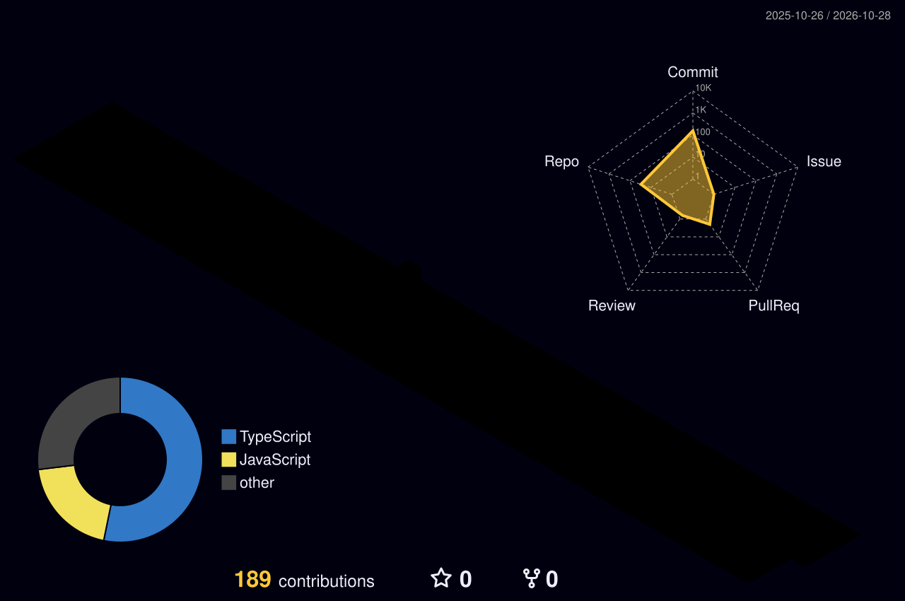

<!-- ============ HEADER ============ -->
<div align="center">


<a href="https://git.io/typing-svg">
  
</a>

<br/>


<a href="https://chirag-tank-portfolio-web.vercel.app/"></a>
<a href="https://www.linkedin.com/in/chirag-tank-72220919b/"></a>
<a href="mailto:chiragtank1971@gmail.com"></a>

</div>

<br/>

<!-- ============ ABOUT ============ -->
## 👨‍💻 About Me

```js
const chirag = {
  role: "Full Stack Developer @ Mintergraph (Jaipur)",
  education: ["MCA (2026)", "BCA (2024)"],
  stack: ["React", "Node.js", "ASP.NET Core", "FastAPI"],
  aiFocus: ["Gemini API", "OpenRouter", "RAG", "Chroma"],
  currentlyBuilding: "HR Quarterly Review & Appraisal System (KRA scoring)",
  openTo: ["Remote work", "Relocation", "Collaboration"],
};
```

> I build and deploy full-stack apps and like shipping practical AI features that real users actually benefit from.

<br/>

<!-- ============ 3D CONTRIBUTIONS ============ -->
## 🧊 My 3D Contribution Graph

<div align="center">
  <picture>
    <source media="(prefers-color-scheme: dark)" srcset="./profile-3d-contrib/profile-night-rainbow.svg">
    <source media="(prefers-color-scheme: light)" srcset="./profile-3d-contrib/profile-gitblock.svg">
    
  </picture>
</div>

<!-- ============ EXPERIENCE ============ -->
## 💼 Experience

| Period | Role | What I did |
|:--|:--|:--|
| **Sept 2026 – Present** | **Full Stack Developer**, Mintergraph | HR Quarterly Review & Appraisal System: admin, manager and employee workflows with automated KRA scoring (MERN) |
| **Oct 2025 – Jan 2026** | **Associate Full Stack Developer** (Contract), Myna Solutions | Online tutoring platform: React, Node.js, AWS S3, WebSocket live sessions |
| **May – Aug 2025** | **.NET Full Stack Intern**, Pratham Software | Social platform on ASP.NET Core, SQL Server, Angular; ~30% faster queries; AI chat via OpenRouter |
| **3 months** | **Full-Stack Web Developer Intern**, The Good Custom | Hands-on full-stack web development |

<br/>

<!-- ============ PROJECTS ============ -->
## 🚀 Featured Projects

<table>
  <tr>
    <td width="50%" valign="top">
      <h3>📞 <a href="https://github.com/Chirag-Tank1971/TaskFlow">TaskFlow</a></h3>
      <p><b>AI-powered lead & call management platform</b></p>
      <ul>
        <li>Gemini lead categorization with TTL cache, cutting redundant API calls by <b>60–80%</b></li>
        <li>RAG knowledge base (Chroma) with citations</li>
        <li>Role-based access, audit trail, CI/CD</li>
      </ul>
      <br/><br/>
      <a href="https://task-flow-five-snowy.vercel.app"></a>
    </td>
    <td width="50%" valign="top">
      <h3>📈 Binance Futures Trading Bot</h3>
      <p><b>FastAPI bot on Binance Futures Testnet</b></p>
      <ul>
        <li>MARKET / LIMIT orders</li>
        <li>Account and order management</li>
        <li>Structured error handling and logging</li>
      </ul>
      
    </td>
  </tr>
  <tr>
    <td width="50%" valign="top">
      <h3>🏢 HR Quarterly Review & Appraisal</h3>
      <p><b>Multi-role MERN platform (built at Mintergraph)</b></p>
      <ul>
        <li>Admin, manager and employee workflows</li>
        <li>Automated KRA-based scoring</li>
        <li>Quarterly review cycles</li>
      </ul>
      
    </td>
    <td width="50%" valign="top">
      <h3>🗂️ Earlier Projects</h3>
      <ul>
        <li>🏡 <b>SwiftMart</b>: e-commerce</li>
        <li>📰 <b>Personalized News Digest</b>: AI summaries (Nhost, n8n)</li>
        <li>✅ <b>Task Management System</b></li>
        <li>💬 <b>YapShare</b>: social media app</li>
      </ul>
    </td>
  </tr>
</table>

<br/>

<!-- ============ TECH STACK ============ -->
## 🛠️ Tech Stack

<div align="center">

**Languages**<br/>
<br/><br/>

**Frontend**<br/>
<br/><br/>

**Backend**<br/>
<br/><br/>

**Databases**<br/>
 <br/><br/>

**Cloud & DevOps**<br/>
<br/><br/>

**AI & LLM**<br/>


<br/><br/>

**Testing & Tools**<br/>


</div>

<br/>

<!-- ============ STATS ============ -->
## 📊 GitHub Analytics

<div align="center">
  
  
  <br/>
  
</div>

<br/>

<div align="center">
  
</div>

<br/>

<!-- ============ SNAKE ============ -->
<div align="center">
  <picture>
    <source media="(prefers-color-scheme: dark)" srcset="https://raw.githubusercontent.com/Chirag-Tank1971/Chirag-Tank1971/output/github-snake-dark.svg" />
    <source media="(prefers-color-scheme: light)" srcset="https://raw.githubusercontent.com/Chirag-Tank1971/Chirag-Tank1971/output/github-snake.svg" />
    
  </picture>
</div>

<br/>

<!-- ============ CONNECT ============ -->
## 🌍 Let's Connect

<div align="center">

📍 Rajasthan, India · Open to remote work and relocation

<a href="https://chirag-tank-portfolio-web.vercel.app/"></a>
<a href="https://www.linkedin.com/in/chirag-tank-72220919b/"></a>
<a href="mailto:chiragtank1971@gmail.com"></a>

<br/><br/>

*Check out my repositories and feel free to collaborate!* 🚀


</div>
